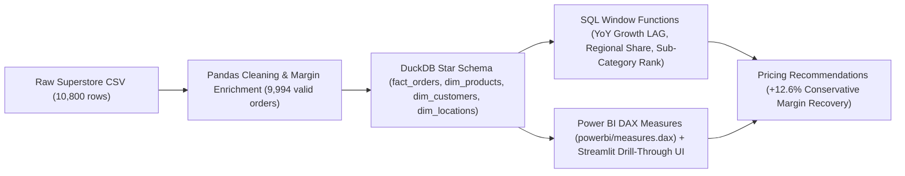
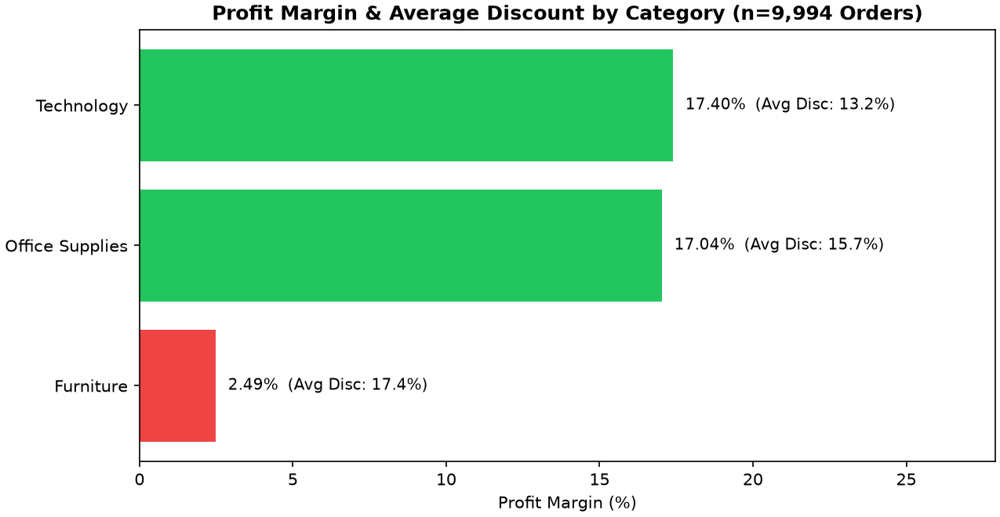
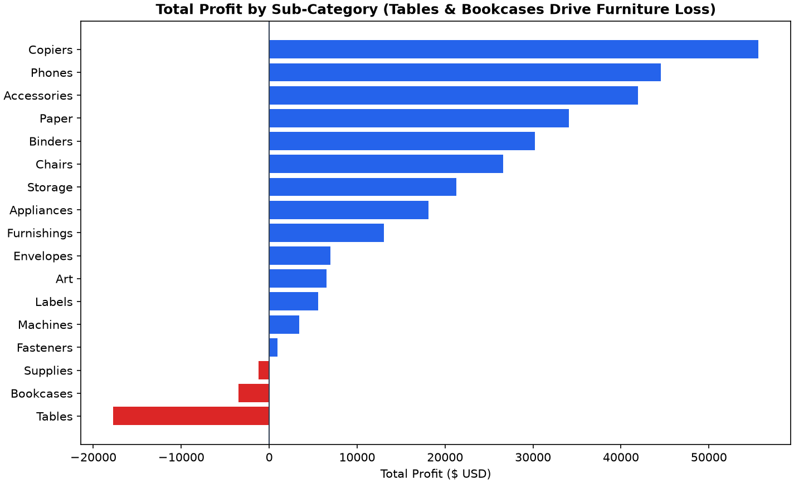

# Retail Sales & KPI Performance Analytics

SQL, Python, and Power BI DAX analytics on the **Superstore Sales Dataset** (`9,994` complete multi-category retail transactions across `4` regions and `3` categories, cleaned from `10,800` raw records).

## Architecture & Workflow



## Key Verified Findings

| Metric | Measured Value |
| :--- | :---: |
| **Total Revenue (`9,994` line items / `5,009` orders)** | **\$2,297,200.86** |
| **Total Profit & Overall Margin** | **\$286,397.02 (12.47%)** |
| **Average Order Value (AOV)** | **\$458.61** |
| **Lowest-Margin Category (`Furniture`)** | **2.49%** (vs. Office Supplies `17.04%`, Technology `17.40%`) |
| **Primary Loss Drivers (`Furniture`)** | **Tables** (`-\$17,725`, `-8.56%`, `26.1%` avg discount) & **Bookcases** (`-\$3,473`, `-3.02%`, `21.1%` avg discount) |
| **Conservative Margin Recovery (15% Tables/Bookcases cap @ 65% elasticity)** | **+\$36,172.08 (+12.63% relative profit recovery; Furniture 2.49% -> 7.36%)** |





## Power BI Deliverables & Mac Interactive BI Dashboard

- **DAX Measures & Star Schema Guide:** [powerbi/measures.dax](powerbi/measures.dax) defines 12 DAX measures (`Total Revenue`, `Total Profit`, `Profit Margin %`, `Order Volume`, `Average Order Value`, `Prior Year Revenue`, `YoY Revenue Growth %`, `Projected Profit After 15% Furniture Cap`, etc.) with Star Schema setup instructions in [powerbi/POWERBI_MODEL_GUIDE.md](powerbi/POWERBI_MODEL_GUIDE.md). *(Note: Power BI Desktop runs natively on Windows to export `.pbix`; this repo includes an interactive Streamlit/Plotly drill-through dashboard on macOS/Linux with full parity.)*
- **SQL Analytics:** [sql/kpi_analytics.sql](sql/kpi_analytics.sql) implements multi-table `JOIN`s, `CTE`s, and `RANK()` / `SUM() OVER` / `LAG()` window functions.
- **Executed Notebook:** [notebooks/superstore_eda.ipynb](notebooks/superstore_eda.ipynb)

## Quickstart

```bash
uv sync --all-groups
uv run python -m retail_kpi.analyze
uv run pytest -v
uv run streamlit run src/retail_kpi/app.py
```
